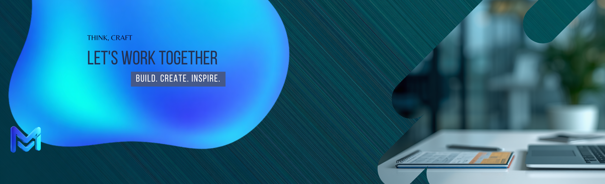
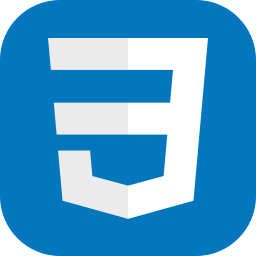
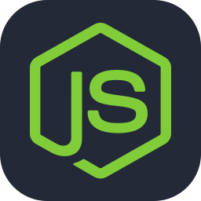
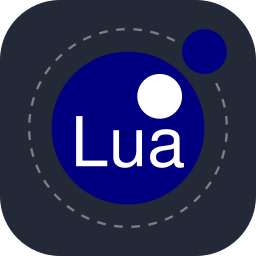
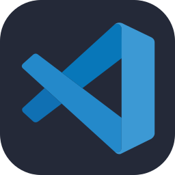

 <p align="center">
  
</p>

<h1 align="center">Muhammad Hussnain</h1>

<h3 align="center">Full Stack Developer | Open Source Enthusiast | Lifelong Learner</h3>

<p align="center">
  Building modern web applications, automating workflows, exploring AI, and understanding the systems behind technology.
</p>

<p align="center">
  <a href="https://github.com/DevMuhammadHussnain">
    
  </a>
  <a href="https://mise-sys.vercel.app/">
    
  </a>
  <a href="mailto:misesysofficial@gmail.com">
    
  </a>
</p>

---

## About Me

I'm a full stack developer who enjoys building useful software, exploring new technologies, and learning how computer systems work beneath the surface.

```ts
const MuhammadHussnain = {
  role: "Full Stack Developer",
  interests: [
    "Web Development",
    "Artificial Intelligence",
    "Automation",
    "Open Source",
    "Developer Tools",
    "System Internals",
    "Roblox Development",
  ],
  currentlyLearning: [
    "System Design",
    "Operating Systems",
    "Computer Networking",
    "Cyber Security",
    "Cloud Computing",
    "Reverse Engineering",
    "Machine Learning",
  ],
  website: "https://mise-sys.vercel.app/",
  email: "misesysofficial@gmail.com",
  motto: "Keep building. Keep learning. Keep exploring.",
};
```

---

## Technology Stack

### Frontend Development

<p align="center">
  
  
  
  
  
  
</p>

### Backend & Databases

<p align="center">
  
  
  
  
</p>

### Programming Languages

<p align="center">
  
  
  
  
  
  
  
</p>

### Development Tools & Platforms

<p align="center">
  
  
  
  
  
  
</p>

---

## Areas of Interest

- Full stack web development
- React and Next.js ecosystems
- Artificial intelligence and machine learning
- Operating systems and low-level programming
- Computer networks and cyber security
- Cloud computing and DevOps
- Open source and developer tooling
- Automation and performance optimization

---

## Currently Learning

I'm focused on understanding how technologies work internally, not just how to use their frameworks and tools.

- Artificial intelligence and machine learning
- System design and software architecture
- Operating systems and Linux internals
- Computer networking
- Cyber security and reverse engineering
- Cloud computing and DevOps
- Performance optimization

---

## Development Experience

**Web Development**
- Next.js, React, JavaScript, TypeScript
- HTML5 and CSS3
- Modern full stack application development

**Databases**
- MongoDB
- MySQL
- SQLite
- SQL and NoSQL fundamentals

**Programming**
- TypeScript and JavaScript
- Python
- C and C#
- Lua and Rust

**Tools & Environments**
- Git and GitHub
- GitHub Actions
- Visual Studio Code
- Linux and Bash

---

## What I Love Building

- Modern web applications
- Developer tools and utilities
- Open source projects
- Automation scripts
- Security-focused tools
- Interactive dashboards
- AI-powered applications

---

## Current Goals

- Build impactful open source projects
- Develop a deeper understanding of computer systems
- Learn concepts thoroughly rather than superficially
- Contribute to the developer community
- Build useful software that solves real problems

---

## GitHub & Coding Activity

<!--START_SECTION:waka-->

```txt
From: 19 January 2026 - To: 18 October 2026

Total Time: 167 hrs 11 mins

TypeScript           66 hrs 16 mins        █████████▓░░░░░░░░░░░░░░░   39.04 %
Python               25 hrs 48 mins        ███▓░░░░░░░░░░░░░░░░░░░░░   15.20 %
CSS                  22 hrs 34 mins        ███▒░░░░░░░░░░░░░░░░░░░░░   13.30 %
JSON                 13 hrs 25 mins        ██░░░░░░░░░░░░░░░░░░░░░░░   07.91 %
Rust                 13 hrs 22 mins        ██░░░░░░░░░░░░░░░░░░░░░░░   07.88 %
HTML                 8 hrs 2 mins          █▒░░░░░░░░░░░░░░░░░░░░░░░   04.73 %
JavaScript           5 hrs 10 mins         ▓░░░░░░░░░░░░░░░░░░░░░░░░   03.05 %
Other                2 hrs 34 mins         ▒░░░░░░░░░░░░░░░░░░░░░░░░   01.52 %
```

<!--END_SECTION:waka-->

---

## Connect With Me

<p align="center">
  <a href="https://github.com/DevMuhammadHussnain">
    
  </a>
  <a href="https://mise-sys.vercel.app/">
    
  </a>
  <a href="mailto:misesysofficial@gmail.com">
    
  </a>
</p>

---

## Philosophy

> Learn deeply. Build consistently. Automate repetitive work. Share knowledge. Stay curious. Never stop improving.

---

<p align="center">
  Thanks for visiting my profile!
  <br><br>
  If you find my work useful, consider giving a star to my repositories.
  <br><br>
  <strong>Happy Coding! 🚀</strong>
</p>
